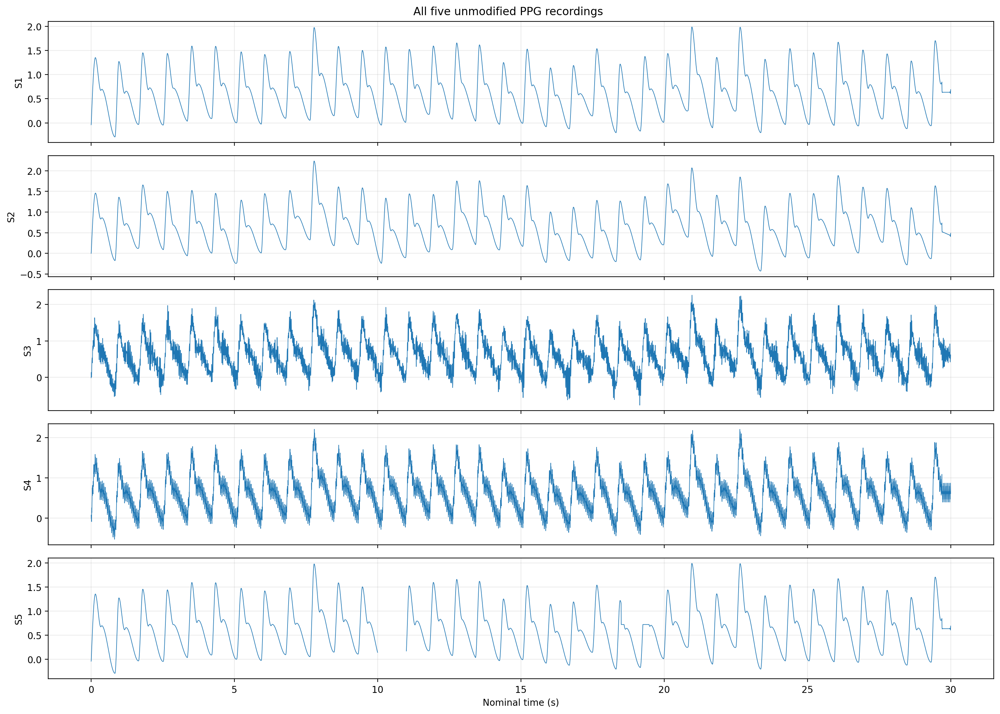
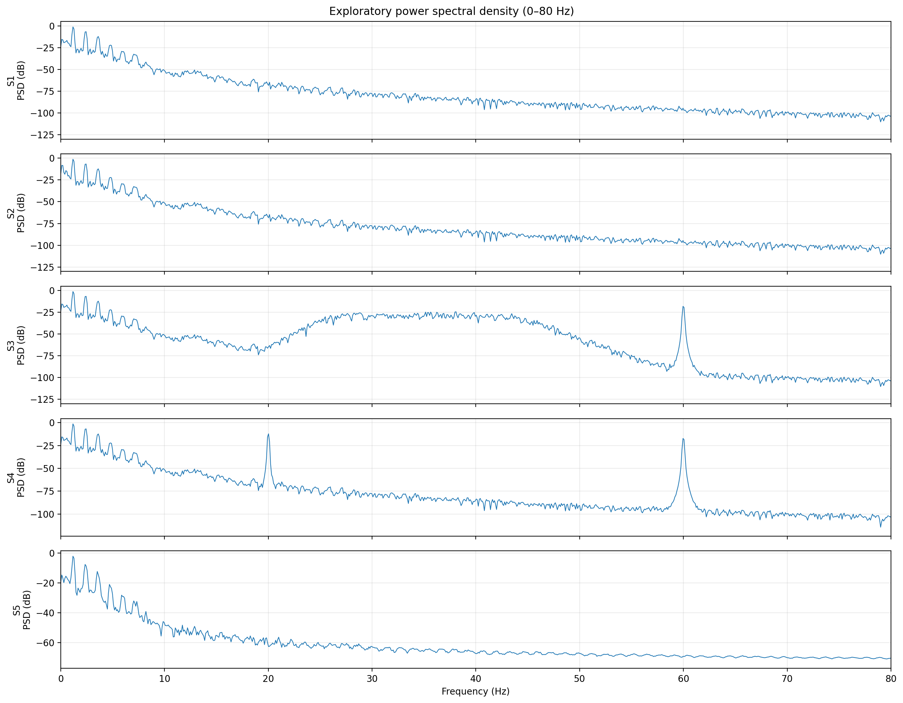
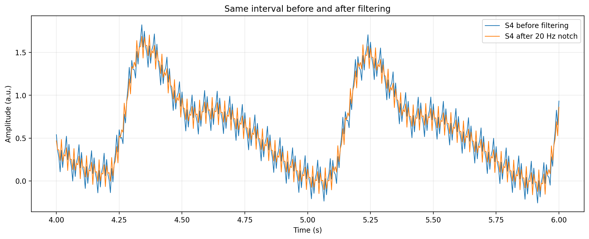

# PPG Signal Quality and Artifact Detection

A Python-based signal-processing project focused on analyzing photoplethysmography (PPG) signals, identifying signal-quality issues, inspecting frequency-domain interference, and evaluating digital notch filtering.

## Project Overview

Photoplethysmography (PPG) is an optical sensing technique used to observe changes in blood-volume-related signals. Reliable PPG analysis requires attention to signal quality, unwanted frequency components, missing samples, and the limitations of downstream measurements.

This project investigates multiple PPG signal streams using Python and scientific computing libraries. It combines time-domain visualization, power spectral density analysis, sample-integrity checks, and an offline notch-filter experiment.

## Objectives

- Inspect PPG waveforms for amplitude and baseline variations.
- Analyze frequency-domain characteristics using power spectral density (PSD).
- Identify missing samples and assess recording integrity.
- Investigate a prominent spectral component near 20 Hz.
- Apply a 20 Hz IIR notch filter and compare the signal before and after filtering.
- Examine peak-detection results and document the limitations of the analysis.

## Tools and Technologies

- Python
- NumPy
- pandas
- SciPy
- Matplotlib
- Jupyter Notebook

## Repository Structure

```text
PPG-Signal-Quality-Analysis/
├── README.md
├── requirements.txt
├── .gitignore
├── notebooks/
│   └── PPG_Signal_Quality_Analysis.ipynb
├── outputs/
│   └── plots/
│       ├── raw_waveforms.png
│       ├── power_spectra.png
│       ├── s4_before_after.png
│       ├── s4_filter_spectrum.png
│       └── s4_peak_detection.png
└── data/  # Include only when redistribution is permitted
```

## Analysis Workflow

### 1. Time-Domain Inspection

Visualize the PPG streams and inspect their amplitude, baseline, and waveform characteristics. Use the plots to identify segments that may require further investigation.

### 2. Frequency-Domain Analysis

Estimate power spectral density to examine the distribution of signal energy across frequencies. A prominent narrowband component was observed near 20 Hz in one stream.

### 3. Sample-Integrity Assessment

At a sampling rate of 200 Hz, a 30-second recording is expected to contain:

\[
N = f_s T = 200 \times 30 = 6000
\]

The observed fifth stream contained 5,800 samples, indicating 200 missing samples, equivalent to approximately one second of data.

### 4. Notch-Filter Experiment

Apply a 20 Hz IIR notch filter with \(Q=25\) to investigate attenuation of the narrowband component. Offline forward-backward filtering is used for the comparison.

Compare the original and filtered waveforms and their power spectra to evaluate the filter's effect.

### 5. Peak-Detection Review

Compare peak detections before and after filtering. Differences in detected peak counts and timing require careful validation; they do not independently establish improved physiological measurement accuracy.

## Key Findings

- Five PPG signal streams were analyzed.
- A prominent spectral component near 20 Hz was observed in one stream.
- A 200-sample gap was identified in another stream.
- Notch filtering substantially reduced the prominent component near 20 Hz in the observed spectrum.
- Peak-detection results differed before and after filtering, so further validation is needed before claiming an improvement in measurement accuracy.

## Results and Visualizations

### Raw PPG Waveforms


### Power Spectral Density


### S4 Filtering Comparison


## Limitations

- The physical source of the narrowband component cannot be established from the spectrum alone.
- Missing samples can affect downstream processing and must not be silently treated as valid observations.
- Visual similarity between filtered and original waveforms is not sufficient to prove that useful signal features are preserved.
- Peak-detection improvement requires matched-peak analysis and appropriate validation.
- The notch-filter experiment is an offline analysis, not a demonstration of a validated real-time medical device.

## How to Run

1. Install Python and Jupyter Notebook.
2. Install the dependencies listed in `requirements.txt`.
3. Open `notebooks/PPG_Signal_Quality_Analysis.ipynb`.
4. Ensure the authorized dataset is available at the path expected by the notebook.
5. Run the notebook cells in order and inspect the resulting plots.

If the original dataset cannot be redistributed, obtain it through the authorized assessment source rather than downloading it from this repository.

## Intended Use

This project demonstrates exploratory signal processing and data-integrity analysis for learning and portfolio purposes. It is not a clinically validated diagnostic system.

## Author

Avinash Raj

Electronics and Communication Engineering

Vellore Institute of Technology, Bhopal
